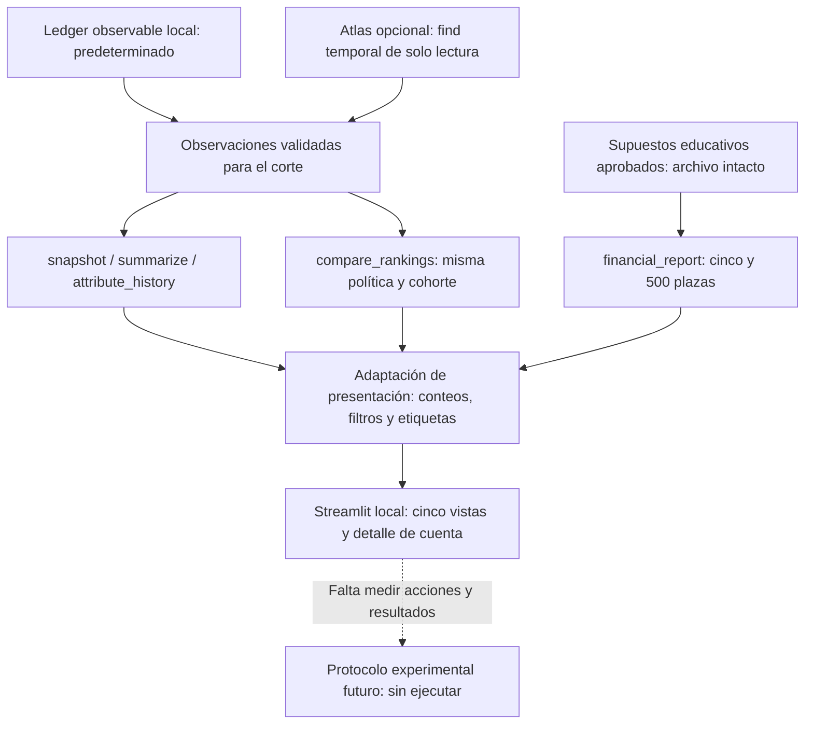

# Control Tower local — diseño aprobado e implementación 004B

**Estado: CT-01 a CT-05 aprobadas expresamente por el usuario en 004B**, con ampliación de CT-02 para red interactiva sencilla. Versión `004b-design-v2`. Aplicación local y adaptador implementados en la rama del PR #6; revisión visual nativa Windows pendiente antes de integrar. Ledger, políticas, supuestos financieros y Atlas intactos. [Guía de uso y demo](18-control-tower-demo.md).

## 1. Qué debe demostrar y qué no sabemos

Base auditada: `main` en `8e39c8bec3518eb4c0929cd3ab4eeabcda6a9fbb`, que incluye 002B/002C, 003A con corrección Windows y 003B. Se releyeron las 13 diapositivas y notas del [reto original](../presentations/references/Reto-AI-Engineering-SME-Economic-Graph.pptx), en especial 10–12: Control Tower obligatoria, cuatro dimensiones, funnel segmentable y seis entregables. El tablero será evidencia para el bloque 6 de [trazabilidad](02-challenge-traceability.md); no reemplaza el brief final ni completa los experimentos.

La pregunta ejecutiva es: **¿qué sabe la Telco, qué cuentas prioriza por esa evidencia y qué necesitaría medir para saber si produce margen adicional?** La interfaz debe mostrar la cadena, incluidos sus eslabones sin datos. El score 87 y el funnel de la presentación original son ilustraciones; no se importan como resultados.

| Naturaleza | Etiqueta siempre visible | Fuente y límite |
|---|---|---|
| Datos ficticios observables | **Sintético observable** | Ledger público por disponibilidad; leerlo desde Atlas no lo convierte en dato real de clientes |
| Ejecuciones técnicas | **Verificado offline / reporte local del usuario / lectura actual**, según corresponda | [002C](11-atlas-integration-validation.md) es reporte Windows del usuario; no prueba conectividad cloud actual ni la nueva UI |
| Finanzas | **Hipótesis educativa no calibrada** | `003b-finance-v1`, aprobación provisional ECO-01 a ECO-06; no finanzas observadas de Totalplay |
| Medición causal | **Experimento futuro, no ejecutado** | Diseño ITT por bolsas; sin muestra, intervalos de efecto ni potencia efectivamente demostrada |

No hay contactos, oportunidades comerciales, activaciones ni ventas en los insumos. El tablero mostrará **No observado**, con motivo, en lugar de cero o una conversión inventada. Tampoco hay etiquetas para precision, recall, Precision@K, lift predictivo, calibración ni resultados causales. Una cuenta priorizada no es un lead calificado ni permiso de contacto.

## 2. Evaluación técnica para el plazo

| Opción | Aporte | Costo y compromiso | Recomendación |
|---|---|---|---|
| Streamlit local | Selectores, tablas, tarjetas, gráficos simples y detalle interactivo en Python; reutiliza funciones sin API adicional | Añade dependencias transitivas y un proceso web local; requiere instalar/verificar en Windows antes de demostrar | **Aprobada CT-01**, revisión nativa Windows pendiente |
| CLI y Markdown actuales | Sin nuevas dependencias; fallback reproducible ya disponible | Navegación y segmentación manuales; experiencia menos fluida ante evaluadores | Conservar como respaldo, no declarar que ya existe tablero |
| HTML estático o aplicación web propia | Puede evitar Streamlit o dar más control | HTML simple pierde interacción; añadir filtros y estado propios aumenta trabajo y riesgo de duplicar lógica | No priorizar para este plazo |

En la consulta oficial a [PyPI](https://pypi.org/pypi/streamlit/json), Streamlit **1.66.0** declara Python `>=3.11`, compatible por declaración con Python 3.12 del proyecto. Entre sus dependencias están pandas, NumPy, PyArrow, Altair y PyDeck; no es una dependencia pequeña. En 004B se instaló esa versión fijada mediante el grupo opcional `ui` y `uv.lock`. Se comprobó en Linux; compatibilidad nativa Windows de esta UI pendiente de ejecución en ese equipo.

Decisión aprobada: grupo opcional de desarrollo `ui` con **solo Streamlit como dependencia directa nueva**, sin extras. Las CLI y pruebas de dominio conservan instalación base independiente. No añadir directamente Plotly, NetworkX, PyVis, otra base, API, autenticación o servicios. La ampliación CT-02 se resuelve con Vega-Lite integrado en Streamlit, layout circular determinista con biblioteca estándar y selector sincronizado; no se requiere otra dependencia directa, editor, motor de grafos o selección directa de nodos.

Una aplicación Python local, un proceso y navegador, escuchando en `127.0.0.1`. Telemetría desactivada (`browser.gatherUsageStats=false`) en `.streamlit/config.toml`, sin recursos/CDN/mapas externos en los gráficos. Sin publicación cloud, agentes, acciones comerciales ni cambios a red de Atlas. Offline significa ejecución sobre archivos después de instalar las dependencias; la instalación inicial puede necesitar PyPI o caché. No se publican enlaces de preview desde Codex Cloud.

## 3. Arquitectura propuesta y fuentes únicas



La flecha hacia el experimento es trabajo pendiente, no una conexión de datos ni causalidad demostrada. El calculador financiero no recibe empresas, sectores, scores ni cantidades filtradas. No hay camino desde el catálogo/oráculo hacia la UI.

Archivos implementados en 004B: `app/control_tower.py` para composición/estado y `src/economic_graph/tower_read_model.py` para adaptar salidas a tablas, red y conteos descriptivos. Funciones sin jerarquías ni nueva capa de servicios. No se copian fórmulas de scoring/finanzas ni reglas de elegibilidad.

| Fuente existente | Consumo propuesto y responsabilidad |
|---|---|
| `observable.load_observations` | Única lectura local empresarial: `data/observable/observations.json`; no reconstruirlo ni abrir planes restringidos |
| `snapshot`, `summarize` | Perfiles, relaciones, estados de consolidación, conflictos e identidades al corte; conteos del visor existente |
| `attribute_history` | Historial con fuente, observación y fechas de un atributo de cuenta conocida |
| `compare_rankings` | Elegibilidad/exclusiones, scores, contribuciones, posiciones, top-5 y empates: fuente autorizada para decisiones |
| `load_financial_config`, `financial_report` | Finanzas educativas y sensibilidad, sin editar supuestos ni reimplementar cálculos; conservar Decimal/cadenas y unidades |
| `load_config`, `create_client`, `read_observations` | Solo si el operador elige Atlas; base dedicada y `find` con `available_at <= as_of`; cierre explícito del cliente |
| `docs/11`, decisiones y reportes de pruebas | Evidencia técnica con procedencia; no fingir que la UI ejecutó lo documentado |

Cada actualización construye un contexto consistente: fuente, corte exacto UTC, observaciones materializadas, snapshot e informe de rankings de esas mismas filas; versión de política y hash visible. Los conteos descriptivos del adaptador solo agregan esas salidas. Finanzas tiene contexto separado: versión, hash de supuestos, ventana de 90 días, H de 12 meses y descuento, no una fecha T0/T1/T2.

Para la primera versión se propone estado de sesión local, sin caché persistente ni cliente MongoDB global. Los archivos pequeños pueden recargarse al cambiar de corte. Atlas se consulta solo mediante acción explícita de lectura/actualización; el resultado público se conserva en sesión para que un filtro de tabla no abra otra conexión. Cambiar fuente/corte invalida resultados anteriores; no se mezclan contextos. No guardar URI ni credenciales en la sesión, URL, widgets, logs o exportaciones.

## 4. Arquitectura visual y navegación

CT-02 aprobada: cinco vistas en un selector lateral, una sola aplicación, sin menús profundos. Inicio en Resumen, T2 y Offline:

| Vista | Pregunta ejecutiva y contenido principal |
|---|---|
| **Resumen** | Qué conocemos, qué cambia en la decisión, qué falta medir y qué margen es solo una hipótesis. Cuatro tarjetas con sus etiquetas de naturaleza y vínculos a cada dimensión |
| **Graph Health** | Conteos y evolución; red observable con selector sincronizado y tabla de afirmaciones, estados, fuentes, conflictos e identidades candidatas; evidencia desplegable |
| **AI Performance** | Subtítulo «Comparación de reglas, sin modelo entrenado»; baseline y grafo lado a lado, posiciones globales, contribuciones, cobertura y empates |
| **Business Funnel** | Conocidas → elegibles → priorizadas por la política elegida; exclusiones como rama aparte; acción/resultado sin datos marcados No observado |
| **Economic Impact** | Cinco plazas y 500 hipotéticas claramente separadas; cuatro escenarios, componentes, reserva, sensibilidad y equilibrio; protocolo futuro y límites |

El detalle de cuenta es un panel desplegable común a Graph Health, AI Performance y Funnel, no una sexta aplicación. Navegar desde una fila conserva corte, fuente e ID público; si la cuenta no era conocida en un corte anterior, se muestra «No conocida al corte» y se limpia su ficha, sin buscar el catálogo.

En Resumen, la cadena visible es **evidencia → score → plaza priorizada → contacto (No observado) → resultado comercial (No observado)**. El caso económico aparece en paralelo como hipótesis de qué efecto sería necesario para cubrir costos, nunca como ingreso producido por esa cadena.

Wireframe orientativo, no interfaz ejecutable:

```text
ConectaPyME | Control Tower                 SINTÉTICO OBSERVABLE
Fuente: Offline | Corte: T2 · 2026-09-15T12:00:00Z | Política y procedencia
┌──────────────────────┬────────────────────────────────────────────────┐
│ Navegación           │ Resumen / dimensión elegida                   │
│ Resumen              │ [Dato conocido] [Decisión] [No observado]     │
│ Graph Health         │ [Hipótesis económica: contexto independiente] │
│ AI Performance       │                                                │
│ Business Funnel      │ Tabla o barras simples + explicación          │
│ Economic Impact      │ Evidencia / límites / siguiente paso           │
│                      │                                                │
│ Industria / Cuenta   │ Detalle de cuenta > razones > observaciones   │
│ [Solo inspección]    │ Fechas · fuentes · estado · conflictos         │
└──────────────────────┴────────────────────────────────────────────────┘
```

Fondo neutro, tipografía predeterminada, jerarquía clara y tablas legibles en portátil. Azul para contexto/datos, ámbar para incertidumbre/hipótesis, texto y signo para pérdidas; ningún estado se comunica solo por color. No semáforos de «salud buena» ni «inversión aprobada» sin regla validada. Etiquetas descriptivas, ayuda breve de métricas y unidades en cabeceras. Sin animación, CSS personalizado o diseño móvil dedicado.

## 5. Diccionario mínimo de indicadores

### Graph Health

| Indicador | Definición/fuente exacta | Interpretación |
|---|---|---|
| Empresas conocidas | `summarize(snapshot).companies` | Empresas descubiertas al corte; no tamaño total del mundo privado |
| Afirmaciones económicas observadas | `summarize(...).relationship_claims` | IDs de relación distintos en la vista, sin REFERS_TO; incluye su estado, no afirma verdad ni actividad transaccional |
| Referencias comerciales | `summarize(...).referrals` | Separadas de suministros/alianzas; no se suman como ventas |
| Observaciones | `summarize(...).observations` | Registros acumulados visibles; no se confunden con relaciones únicas |
| Estados y procedencia | Agrupar `snapshot.relationships.verification_status` y `snapshot.observations.source_type` | Estados actuales por afirmación vs estados históricos por observación, en tablas separadas; sin confidence score numérico inventado |
| Conflictos | `snapshot.conflicts` / `summarize(...).conflicted_attributes` | Pares cuenta/atributo sin arbitraje, no observaciones «resueltas» |
| Posibles duplicados | `snapshot.identities` / `identity_candidates` | Registros candidatos, no duplicados confirmados; conservar NEEDS_REVIEW y candidatos sin fusionar |
| Estado de identidad | Distribución `snapshot.companies.identity_status` | Hoy todas NEEDS_REVIEW; no medir exactitud de entity resolution sin etiquetas |
| Edad de evidencia | Mediana de `as_of − observed_at` en días de observaciones visibles, con denominador | Frescura descriptiva respecto al corte, no a «hoy»; no demuestra vigencia ni usa un SLA inventado. Mostrar fechas de disponibilidad por separado |

Los estados de consolidación de `snapshot` y los diagnósticos de utilidad para scoring de `compare_rankings` tienen propósitos diferentes. Si un reporte adicional cambia `scoring_status` a CONFLICTED, la UI muestra ambos con su evidencia; no homogeneiza ni promociona estados. Una afirmación confirmada no se declara verdadera por consultar el simulador.

La evolución muestra únicamente cortes **hasta el seleccionado**: T0 solo T0; T1 incluye T0/T1; T2 incluye los tres. En Atlas se reconstruye del mismo lote público leído manualmente al corte principal, aplicando disponibilidad a cada punto, sin completar historia con archivos de otro origen. Cambiar el corte principal exige una nueva lectura explícita. Los nombres/opciones tampoco incluyen empresas futuras. No se muestra «23 de 30» ni «7 desconocidas»: el denominador privado no pertenece al consumidor comercial.

### AI Performance

| Indicador | Fuente/denominador | Límite |
|---|---|---|
| Posiciones, scores y diferencias | `compare_rankings.companies`; `position_change` | Conservar posiciones globales, versión, pesos, reglas, contribuciones y evidencia |
| Top-5 y cambios | `top_k` y `comparison.shared/entered_graph/left_baseline` | Cinco plazas por política; no sumar ambas listas como diez contactos |
| Empates en la quinta plaza | `comparison.baseline_boundary/graph_boundary` | Mostrar `crosses_tie`, puntaje y cuentas empatadas; desempate por ID no significa prioridad comercial |
| Cobertura individual utilizable | Elegibles cuya feature `additional_branches.status == OBSERVED` / elegibles | Incluye una sucursal con contribución cero; cobertura no es puntuación positiva |
| Señal relacional utilizable | Elegibles con `confirmed_neighbors.value > 0` / elegibles | Cero significa ningún vecino confirmado utilizable; no inexistencia de relaciones |
| Métricas predictivas | **No disponibles** | Sin etiquetas/modelo: no precision, recall, Precision@K, lift predictivo, calibración ni drift validado. Mostrar cambios de evidencia, no calidad predictiva |

Si no hay elegibles, cobertura es **No aplica: denominador cero**, no 0% de desempeño. El panel de contribuciones copia el resultado del módulo; no ajusta pesos ni vuelve a contar vecinos tras filtrar la tabla.

### Business Funnel

Conocidas, elegibles y excluidas proceden del mismo informe: `known_companies`, `eligible_companies`, `excluded`; **conocidas = elegibles + excluidas**. Priorizadas = tamaño de `top_k[política elegida]`, no el total de elegibles ni el número de scores positivos. El selector de política es visual y no crea intervención comercial.

Representar una tabla de etapas/ramas y, como máximo, barras para cantidades conocidas. Contactos, oportunidades, contactos activados, activaciones y ventas: `valor=null`, etiqueta **No observado**, causa «sin eventos comerciales en los insumos». No dibujar barras de longitud cero ni tasas de conversión entre esas etapas. Adquisición real de no-clientes sigue requiriendo validación: elegible para este ranking no equivale a elegible operativamente para el ensayo.

### Economic Impact

Consumir `financial_report` y sus componentes: saldo neto, reserva, saldo tras reserva, contribución de costos/margen, `break_even`, `required_with_reserve`, factibilidad y sensibilidad. Mostrar base/conservador/optimista/nulo sin ocultar pérdidas; seleccionar una fila solo abre detalle, no elimina el cuadro completo. Los cinco y 500 lugares son hipótesis de capacidad, no empresas observadas o tamaño de muestra.

Los valores proceden del archivo aprobado, inicialmente **sin edición de parámetros ni carga de archivos desde la UI**. Conservar unidades, horizonte, descuento y hash; no volver a descontar ni calcular desde números redondeados. La tabla conserva cadenas/Decimal; convertir a valores de dibujo solo para gráficos, sin usar floats de presentación como entrada del modelo.

`clears_reserve_mathematically` no será un semáforo de inversión. Mostrar siempre `operational_authorization=false`. El nulo es Δp=0 y puede tener saldo negativo; el saldo cero es otra referencia algebraica. ROI real, CAC incremental observado, LTV, payback y efecto con IC: **No disponibles**, con datos requeridos y vínculo al protocolo ITT. El IC95% y potencia80% son objetivos metodológicos, no resultados. No se ejecuta A/B ni se calcula muestra.

## 6. Filtros y segmentación sin alterar decisiones

CT-03 propone separar **contexto**, **segmento empresarial** y **filtros de inspección**. El contexto recalcula solo con módulos existentes; el segmento cuenta pertenencias al resultado ya calculado. No aplica `compare_rankings` a filas de evidencia recortadas ni rellena plazas dentro de cada sector.

| Filtro solicitado/disponible | Soporte y comportamiento propuesto |
|---|---|
| Período | T0/T1/T2 con hora y zona exactas de `contracts.CUTS`; no fecha sin hora ni inferir fin de día. Finanzas muestra H/W/d aparte |
| Industria | Atributo observable `sector`; opciones solo conocidas al corte, incluyendo «Desconocida» y «En conflicto» si existen. No usar catálogo para completar |
| Empresa | ID público CO-… y nombre observado al corte; aliases solo candidatos en detalle. Nada de EMP-… ni autocompletar empresas no descubiertas |
| Score | Rango de score y política de referencia, **solo tabla de ranking**; no afecta elegibilidad, top-5 global o etapas sin score |
| Fuente, tipo de vínculo, estado | Inspección de tablas de observaciones/afirmaciones, sin eliminar evidencia de entrada ni cambiar indicadores de priorización |
| Seleccionadas/excluidas/identidad/conflicto | Vistas sobre listas y estados de módulos, con etiquetas claras; sin resolver casos |
| Geografía | **Deshabilitado: sin atributo por empresa**. Distrito Centro/Villa Conecta es contexto ficticio común, no segmentación observada |
| Cluster/comunidad | **Pendiente: no existe asignación observada/calculada aprobada**. No inventar comunidades o bolsas A/B |
| Producto y canal | **Deshabilitados: sin datos**; source_type no se renombra como canal comercial |
| Tamaño/sucursales/calificación | Mostrar en ficha con UNKNOWN/CONFLICTED. No añadir filtros a la primera versión: cobertura muy escasa, sin dato consolidado de tamaño |

Los filtros de industria/empresa generan un conjunto S de IDs conocidos. En Funnel se muestran conocidas/eligibles/excluidas de S y **seleccionadas del top-5 global que pertenecen a S**; pueden ser menos de cinco. En AI se filtran filas y se conservan posiciones, contribuciones y empates globales; las tarjetas globales dicen «Global al corte», y los conteos segmentados llevan «Segmento / total».

En Graph Health, las relaciones segmentadas son las **incidentes a al menos una cuenta de S**, deduplicadas por LINK-ID; pueden tener otro extremo fuera del segmento, siempre conocido al corte y rotulado como contexto. No se suman totales sectoriales de relaciones como si fueran disjuntos. Los historiales/fuentes se inspeccionan mediante IDs de observación relacionados; los candidatos de identidad mantienen su propia lista global y se vinculan a una cuenta solo como candidatos, nunca como fusión. Conteos de fuente/estado siempre explicitan si son globales o de las filas inspeccionadas.

Los filtros de cuenta/sector/corte **no recalculan ni segmentan la economía**: no existen márgenes por empresa/industria ni una relación validada score→Δp. En Economic Impact se desactivan con aviso «Supuestos agregados independientes del corte y segmento empresarial». En Resumen, la tarjeta económica lleva esa misma advertencia. Los controles propios de economía solo eligen modo/detalle de los escenarios y sensibilidad aprobados.

## 7. Trazabilidad de una cuenta

Ruta visible: **cuenta conocida → elegibilidad/exclusión → posiciones y selección → features/contribuciones → IDs de relación/observación → fuente, observed_at, recorded_at, available_at, estado y nota**. Atributos contradictorios conservan todas sus observaciones; observaciones repetidas no suman puntos. Vecinos fuera del segmento se muestran como respaldo contextual sin recontar ni ocultar el motivo del score. Una cuenta excluida muestra su motivo, no un score inventado.

Guion de demostración: en T2, Café Jacaranda pasa de posición baseline10/score0 a grafo3/score10, por dos vecinos confirmados utilizables según 003A. Abrir sus evidencias y después Hornos del Centro: cero contribución por sucursales en conflicto no equivale a cero sucursales. Mostrar el alias NEEDS_REVIEW sin fusionar. Cambiar a T0 reduce conocimiento y evidencia, sin filtrar datos futuros. Terminar en Funnel con acción no observada y Economía como hipótesis, sin adjudicarle ventas a ninguna cuenta.

## 8. Atlas opcional, fallos y procedencia técnica

CT-05 propone modo offline predeterminado que no consulta `.env` ni crea clientes. Atlas solo por selección y botón explícito de lectura. Usar la base dedicada `conectapyme_mvp_observable` y `m002b_observations`, sin cargas, metadata de escritura, índices, stats administrativos o cambios de seguridad. Recomendar credencial distinta con acceso limitado a lectura; los roles actuales no se presentan como verificados. Validar base antes de abrir cliente y reutilizar filtro temporal del módulo.

Una fábrica de cliente no confirma lectura: solo una respuesta real exitosa se rotula «Lectura Atlas realizada en esta sesión». Mostrar instante UTC de lectura, corte de datos y hash sin URI. Comparar hash visible con el ledger aprobado al mismo corte; ante divergencia, avisar «Datos distintos del ledger aprobado» y bloquear la demostración comparable hasta investigación, sin sobrescribir ni corregir nada. Ante fallo, mostrar mensaje seguro y opción de volver explícitamente a offline: **no fallback silencioso** ni etiquetas de Atlas sobre cifras locales.

Estado vacío, archivo ausente/inválido o contrato privado: error claro sin reconstruir el ledger desde simulador ni mostrar widgets con cero como si hubieran cargado datos. La página económica puede seguir disponible con su propia fuente y advertencia de independencia; el Resumen indica que no hay datos empresariales cargados.

Panel de procedencia: fuente/corte/hash actuales, versión de políticas/finanzas, estado de evidencia y vínculo a `docs/11`. El reporte local de 002C no se renombra como ping cloud o éxito de la UI. El repositorio completo sigue siendo accesible al desarrollador; para una demo comercial se entrega solo ledger/configuración/módulos públicos o un acceso MongoDB restringido, sin montar el oráculo. No se promete seguridad multiusuario de producción.

## 9. Criterios de aceptación aprobados

Los valores siguientes se obtuvieron ejecutando módulos existentes sobre el ledger público en esta auditoría; **no son pruebas de una UI ya implementada**:

| Corte | Conocidas | Observaciones | Afirmaciones económicas / referencias | Conflictos / candidatos | Elegibles / excluidas | Cobertura sucursales / vecinos utilizables | Empate límite baseline / grafo |
|---|---:|---:|---|---|---|---|---|
| T0 | 12 | 28 | 2 / 0 | 0 / 0 | 12 / 0 | 2/12 / 4/12 | Sí / No |
| T1 | 17 | 54 | 13 / 2 | 1 / 1 | 17 / 0 | 3/17 / 4/17 | Sí / Sí |
| T2 | 23 | 83 | 26 / 3 | 2 / 2 | 21 / 2 | 3/21 / 5/21 | Sí / Sí |

Por afirmación, estados actuales sumando económicas y referencias: T0=2 CONFIRMED; T1=2 CONFIRMED+12 REPORTED+1 INFERRED; T2=4 CONFIRMED+24 REPORTED+1 INFERRED. No confundirlos con estados de las 83 observaciones ni con vínculos verdaderos del oráculo. En los tres cortes cada política selecciona cinco, con dos en común y tres sustituciones; estas cantidades no son conversión.

Aceptación aprobada, cubierta por pruebas del adaptador y AppTest de Streamlit además de la suite previa, con ejecución nativa Windows pendiente:

1. CT-A01: cinco vistas, cuatro dimensiones explícitas, etiquetas de naturaleza en cada tarjeta/gráfico y detalle legible en portátil; sin contenido que dependa solo de color.
2. CT-A02: paridad exacta de conteos, scores, contribuciones, posiciones, top-5, hashes y finanzas con API/CLI actuales. No implementar otras fórmulas ni modificar entradas aprobadas.
3. CT-A03: aislamiento temporal en datos, nombres/opciones, detalle y evolución; T0 no revela T1/T2 ni empresas desconocidas, metadata privada o denominadores del oráculo.
4. CT-A04: industria/cuenta permiten inspección y funnel segmentado sin alterar rankings globales. Sector desconocido sigue desconocido; filtros de fuente/score no cambian decisiones. Cero filas es un estado vacío explícito, no evidencia comercial negativa.
5. CT-A05: conocidas=elegibles+excluidas; priorizadas por política=5 salvo capacidad no cubierta ya reportada por el módulo. Etapas posteriores null/No observado, sin barras/tasas falsas ni suma de las dos políticas como contactos.
6. CT-A06: cobertura con denominadores explícitos, cero denominador como No aplica; diferencias entre conflicto de dato y diagnóstico de scoring explicadas. Candidatos nunca se fusionan.
7. CT-A07: ficha de Café/Hornos reproducible y evidencia completa al corte, incluidos vecinos de contexto. Una selección de empresa no filtra sus fuentes de entrada para cambiar el score.
8. CT-A08: economía por cinco/500, cuatro escenarios y nulo intactos; base hipotética de 500=39 000 MXN y nulo=−41 000 MXN, sin reserva duplicada. Cambiar industria/cuenta/período no cambia entradas/saldos ni autoriza inversión. IC/potencia se rotulan como diseño futuro.
9. CT-A09: offline inicia sin `.env`, red, Atlas ni directorio restringido, usando solo recursos públicos. Pruebas sin fixtures privados del simulador para renderizar la UI; no callbacks con escritura.
10. CT-A10: Atlas se prueba con doble que solo implementa `find`, filtros temporales y errores redactados; credenciales no aparecen en sesión/URL/exportación. Lectura real opcional se informa como no verificada si no se ejecuta, sin activar la integración histórica que escribe.
11. CT-A11: archivos ausentes/incorrectos y diferencias Atlas/offline fallan de forma visible; cambiar fuente invalida datos anteriores; no resultados mezclados ni fallback silencioso.
12. CT-A12: instalar grupo UI bloqueado y ejecutar demo local en Python3.12, también con la red desconectada después de instalar; comprobar acentos, rutas con espacios y navegación en Windows11 además de pruebas Linux. No afirmar esa ejecución antes de realizarla. Medir tiempo de arranque/refresco en el equipo de demo sin prometer rendimiento de producción.

CT-A13 (ampliación 004B): red con nodos/aristas públicos por corte y selección de conexiones directas; tipo/verificación/procedencia visibles; referencias sin puntuar, conflictos/candidatos sin fusión y nodos aislados identificados; selector no altera scores. Vega-Lite debe validar su esquema, usar datos embebidos sin URL externa y dibujarse realmente en navegador. Fixtures de prueba incluyen descarte y conflicto simultáneo sin alterar el ledger.

La suite UI usa AppTest, sin añadir navegador automatizado como dependencia del proyecto ni infraestructura de CI. Se hizo además una comprobación manual automatizada con Chromium disponible en el entorno Linux; no exige instalarlo para usar o probar la app. Comandos PowerShell y límites de validación en la guía 004B.

## 10. Decisiones CT-01 a CT-05 aprobadas por el usuario en 004B

| ID | Decisión concreta | Alcance de la aprobación |
|---|---|---|
| CT-01 | Streamlit local, grupo opcional `ui`, sin extras ni nuevas dependencias directas adicionales; un proceso, módulos actuales y adaptador fino | Tecnología y costo de dependencias; versión/lock solo en la implementación autorizada |
| CT-02 | Cinco vistas, tarjetas/tablas/barras sencillas, panel de cuenta y red interactiva Vega-Lite con selector sincronizado; paleta neutra con etiquetas | Arquitectura visual y ampliación específica 004B; sin motor especializado |
| CT-03 | Cortes exactos; industria/cuenta como segmentación descriptiva; score/fuente/estado como inspección; posiciones/top-5 globales intactos; filtros sin datos deshabilitados | Semántica de filtros y métricas del segmento |
| CT-04 | Economía de solo lectura, cuadro completo cinco/500 y cuatro escenarios, sin editar supuestos ni asociar resultados a cuentas/sectores; etapas comerciales No observado | Separación visible entre evidencia, hipótesis y experimento futuro |
| CT-05 | Offline por defecto; Atlas opcional/manual y solo lectura, hash de paridad, estados/error sin fallback silencioso; criterios CT-A01 a CT-A12 | Flujo de datos y alcance de validación antes de demostrar |

La aprobación explícita de misión 004B autoriza esta implementación, sin ampliar autorizaciones de datos reales, contactos, presupuesto, piloto operativo o despliegue de 003B. El usuario revisará la experiencia y paridad en Windows antes de integrar; no se integra automáticamente.

## 11. Verificación histórica del entregable documental 004A

Ejecutado en Codex Cloud/Linux sobre esta rama: `uv sync --locked` correcto; `uv run pytest` con integración real desactivada (`RUN_MONGODB_INTEGRATION=0`), **233 aprobadas y 1 omitida**; `uv run ruff check .` y `uv run ruff format --check .`, correctos. También se comprobaron enlaces Markdown locales y `git diff --check`.

En aquella entrega 004A no cambiaron código, pruebas, dependencias, configuración financiera, ledger ni archivos restringidos; no se instaló Streamlit, ejecutó interfaz ni consultó Atlas. Esa evidencia es histórica. La implementación y comprobaciones 004B están documentadas en la guía; no sustituyen la revisión nativa Windows pendiente.
