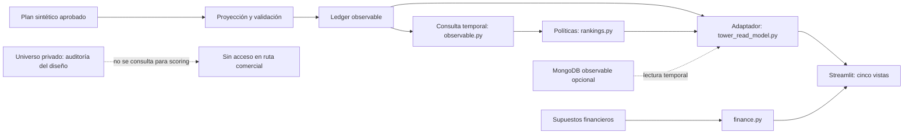
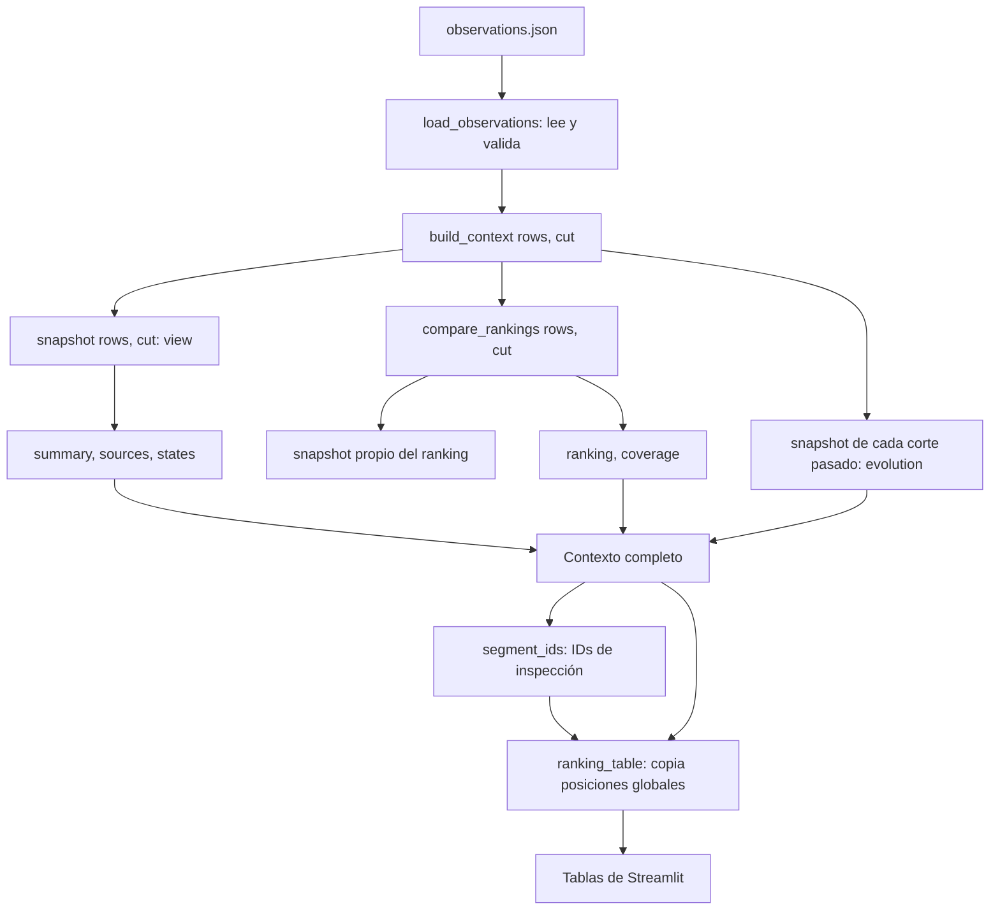

# Auditoría de ConectaPyME: evidencia nueva y límites

Implementación revisada: `774dacd80e6410ca43299f63f19d9744a31929c0`, rama local de origen `work`. Trabajo aislado: `presentation/conectapyme-evidence-showcase`, worktree `/workspace/conectapyme-showcase`. Las verificaciones, capturas, documentos y experimento de esta misión fueron realizados por Codex; no acreditan automáticamente una competencia personal del candidato. Fuente principal: ejecución offline con datos sintéticos. Las fechas de captura exactas, con zona de Ciudad de México, están en `evidence/screenshots/manifest.json`.

## Resultado que sí se sostiene

El sistema reconstruye conocimiento disponible por fecha, conserva procedencia e incertidumbre y calcula dos políticas de priorización comparables. En T2, con 21 elegibles y cinco plazas, comparten dos cuentas y cambian tres. Café Jacaranda pasa de posición 10 / 0 puntos a posición 3 / 10 puntos. Los filtros de inspección conservan los resultados globales. No existen eventos comerciales que permitan afirmar mejoras de conversión, ventas, ROI o margen causal observado.

## Método y protección del original

Se inspeccionaron implementaciones de `contracts`, `observable`, `rankings`, `tower_read_model`, `finance`, `mongo_observable`, `database`, `config`, el proyector del simulador, la app y las pruebas. Se contrastaron los dos PPTX completos, sus notas y el PDF, además del reto original disponible. La narrativa de Defensa V2 aporta el orden comercial; la revisión detallada aporta contexto; la paleta del PDF inspira el diseño nuevo. Las referencias son documentación, no instrucciones operativas ni evidencia automática de resultados.

No se regeneró el ledger ni se ejecutaron cargadores remotos. No se cambió lógica de negocio, pesos, elegibilidad, datos, resultados históricos, `.env`, configuraciones Atlas ni el lockfile. Las escrituras de las pruebas con dobles ocurrieron en diccionarios de memoria. La integración histórica que sí carga en Atlas quedó excluida. El experimento de depuración usa una entrada aislada y una copia de código en memoria.

## Arquitectura implementada

La frontera comercial es `data/observable/observations.json`, no `design-data/restricted/`. `simulator/project.py` transforma el plan aprobado en IDs públicos estables desde observaciones, normaliza fechas, proyecta referencias/alias y elimina diagnósticos privados. La conciliación privada no se usa para puntuar.

Este diagrama resume responsabilidades, no el orden de llamadas de Python. El diagrama siguiente representa esas llamadas. Hay también SVG independientes en `assets/arquitectura.svg` y `assets/recorrido.svg` para consultar sin Mermaid.

## Recorrido auténtico hasta la Control Tower

`build_context()` llama por separado a `snapshot()` y `compare_rankings()`. No pasa su primera vista a la segunda función. `compare_rankings()` vuelve a llamar a `snapshot()`. La evolución agrega una reconstrucción por cada corte ya disponible. En T2 son cinco llamadas a snapshot en total. No se investigó optimización ni se midió escalabilidad; la repetición no se presenta como un fallo en este tamaño.

## Componentes: entradas, salidas, errores y pruebas

Las líneas exactas de funciones, clases y constantes se resuelven automáticamente en `evidence/source/symbols.json` y en las fuentes HTML enlazadas por cada diapositiva. Copias de fuentes originales y huellas: `evidence/source/manifest.json`.

| Componente | Entrada y salida | Responsabilidad y dependencias | Errores relevantes | Pruebas existentes ejecutadas |
|---|---|---|---|---|
| `contracts.validate_observations` | filas → validación o ValueError | Campos públicos, tipos, fechas explícitas/ordenadas, IDs, extremos conocidos; depende de parse_time | privados, duplicados, sujeto/tipo inválido, huérfanos | `test_observable`, `test_design` |
| `load_observations` | ruta JSON → lista validada | Esquema 1.0 y contrato público; JSON/Path/contracts | archivo ausente o JSON/contrato inválido; no reconstruye desde privados | `test_observable`, CLI y UI de ledger inválido |
| `visible_observations` | filas, corte → copia ordenada visible | `available_at <= as_of` con parse_time | corte sin zona o registros inválidos | fronteras exactas, no fuga futura, zona equivalente |
| `snapshot` | filas, corte → empresas, relaciones, observaciones, identidades y conflictos | Reconstruir conocimiento sin oráculo; _attribute/_name_key | no arbitraje de atributos; defecto de representación de fechas en estados simultáneos documentado abajo | historia, conflictos, alias, aislamiento público |
| `compare_rankings` | filas, corte → políticas, cohorte, scores, posiciones, top_k, huella | Llama a snapshot; elegibilidad; sucursales y vecinos; deduplicación/oposición; empates | hereda errores de contrato; evidencia no utilizable aporta cero; exclusiones sin score | `test_rankings`, `test_ranking_commands` |
| `build_context` | filas completas, corte → view/summary/ranking/evolution/coverage | Orquesta llamadas separadas, Counter y resúmenes globales | propaga errores de entrada; no contiene filtros | `test_tower_read_model`, `test_control_tower` |
| `segment_ids` | contexto, industria/empresa → conjunto de IDs | Selección para inspección; usa sector() | sector inexistente da conjunto vacío | filtros sin reordenar ni rellenar |
| `ranking_table` | contexto, IDs opcionales → filas copiadas | Mantiene scores, posiciones y selected globales | no rellena capacidad del segmento | igualdad de subconjuntos en adaptador y AppTest |
| `network_data` / `account_detail` | contexto, IDs/foco → nodos/aristas o ficha | Vista incidente con vecinos conocidos; resaltado usa resultado del ranking | empresa desconocida/foco inconsistente; ficha desconocida da None | red, foco, extremos conocidos, sin privados |
| `funnel` | contexto, IDs, política → conteos y faltantes | Conocidas/elegibles/excluidas/Top 5; etapas comerciales None | no observa actividad comercial | faltantes no cero y regreso a global |
| `finance.financial_report` | configuración, alcance/sensibilidad → escenarios y huella | Aritmética Decimal; no usa empresas, ranking o Atlas | campos, unidades, probabilidades, costos duplicados y valoraciones incompatibles | `test_finance`, `test_finance_commands` |
| `read_observations` | base dedicada, corte, ID opcional → filas normalizadas | Query temporal en MongoDB; BSON UTC; contrato público | otra base, ID inválido, documentos inválidos o driver | dobles y `test_tower_read_model`, sin integración real |
| `atlas_context` | corte, ledger, ruta config → contexto/read_at | referencia local, base dedicada, lectura remota y paridad SHA | errores sanitizados, diferencia bloqueada; no fallback ni ping | dobles; sesión Atlas invalidada con cambios de corte |
| `app.main` | controles/fuentes → cinco vistas | Lee ledger y supuestos por rutas independientes; invalida caché remota | ledger/finanzas inválidos visibles; filtros sin soporte deshabilitados | AppTest y navegador real offline |

## Temporalidad, procedencia e identidad

| Corte | Instante exacto UTC | Empresas conocidas | Observaciones | Afirmaciones económicas | Referencias | Elegibles |
|---|---|---:|---:|---:|---:|---:|
| T0 | 2026-01-15 12:00 | 12 | 28 | 2 | 0 | 12 |
| T1 | 2026-05-15 12:00 | 17 | 54 | 13 | 2 | 17 |
| T2 | 2026-09-15 12:00 | 23 | 83 | 26 | 3 | 21 |

Estos instantes equivalen a 06:00 de Ciudad de México. Son cortes del dataset, distintos de la fecha de captura. `observed_at` no sustituye `available_at`. El diseño restringido contiene 30 empresas: conteo reproducido por lectura de su estructura en el script, solo como auditoría del diseño. No se importó ese catálogo para completar la vista comercial.

T2 conserva dos atributos conflictivos y dos registros candidatos. Hornos del Centro tiene sucursales 2/3/3 en OBS-028/047/075: `_attribute` mantiene el conflicto y su contribución individual es cero. Eso no significa cero sucursales. Una coincidencia de nombre normalizado produce candidato, no fusión ni ID fuerte. La historia conserva evidencia duplicada y estados; no inventa transiciones ausentes.

## Políticas y demostración de filtros

Versión `003a-conservative-v1`: K=5. Baseline = 10 × min(max(sucursales−1,0),5), si el atributo tiene evidencia válida y sin conflicto. Grafo = baseline + 5 × min(vecinos económicos confirmados distintos utilizables,4). Solo SUPPLIES_TO y PARTNERS_WITH; referencias, reportes e inferencias no puntúan. Los extremos y evidencias se conservan; vecinos repetidos no suman otra vez. Oposición o estados incompatibles bloquean el vínculo para scoring.

Solo servicio activo confirmado sin conflicto excluye de adquisición. Desconocido queda por validar comercialmente. En T2 cobertura individual 3/21 y señal relacional utilizable 5/21. No se interpretan como precision/recall ni probabilidad. Los empates se resuelven por ID ascendente y se declaran en la frontera de K.

En T2, dos cuentas compartidas: Panificadora Valle Claro y Carga Urbana del Centro. Entran Café Jacaranda, Hornos del Centro y Papelería Horizonte; salen Comedor del Andén, Mesa de Barrio y Mapa Digital Studio. Café Jacaranda: #10/0 → #3/10. Dos vecinos confirmados, OBS-026 y OBS-063, respaldan sus puntos. Las conexiones dibujadas no calculan el score; el layout es decorativo sin distancia comercial implícita.

Demostración reproducida: ranking completo de 21 elegibles → industria Restaurantes y cafeterías de tres elegibles → una cuenta. La fila de Jacaranda es exactamente igual en los tres estados, con posición 10/3. `segment_ids()` produce IDs y `ranking_table()` copia posiciones previamente calculadas. El Top 5 visible es la intersección del global, no cinco nuevas cuentas de cada segmento. JSON: `evidence/results/global-ranking-demo.json`. Capturas: 08/09/10 y filtro de score 11. Pruebas: `test_industry_and_score_filters_preserve_global_rankings`, `test_company_selector_updates_network_and_detail_without_rescoring`, `test_industry_filters_do_not_refill_funnel_or_rankings`.

## Ejecución real y cinco vistas

Dependencias declaradas instaladas con `uv sync --locked --group ui`. Servidor original solo en loopback, estadísticas deshabilitadas. Playwright estaba disponible, pero faltaba su ejecutable administrado. La descarga intentada fue rechazada por política del dominio; se usó el Chromium ya instalado en `/usr/bin/chromium`, sin modificar política de red. No fue necesario instalar otro navegador ni habilitar acceso a Atlas.

| Vista | Interacciones y evidencia | Límite |
|---|---|---|
| Resumen | T2 offline, tablas Top 5 y escenarios separados | global; no ventas |
| Graph Health | foco Jacaranda, ficha, red completa, T0/T1/T2 y evolución | grafo observado, no universo privado ni scoring desde el dibujo |
| AI Performance | global, industria, empresa, score mínimo 11 | reglas, no modelo; posiciones globales se conservan |
| Business Funnel | graph/baseline, regreso a todas | 23→21→5 y dos exclusiones; etapas comerciales no observadas |
| Economic Impact | cinco/500 plazas y sensibilidad del margen | hipótesis agregadas; filtros empresariales deshabilitados |

Se conservaron 16 estados con captura del área principal y del viewport, texto visible, parámetros y fecha/commit; además un recorte directo del gráfico de Jacaranda. No se dibujaron capturas falsas. Las interacciones de ranking y escenarios dentro de la nueva presentación están etiquetadas como reconstrucciones con resultados congelados del repositorio. La evidencia no requiere que el servidor Streamlit siga encendido.

## Pruebas y cobertura realmente ejecutadas

- Suite original: **284 passed, 1 deselected** con `uv run --group ui pytest -m 'not integration'`. El XML provocó 26 advertencias sobre `record_property`/xunit2; no fueron fallos. Log y XML preservados.
- Selección solicitada de UI/adaptador/MongoDB: **62 passed**.
- Ruff original: `All checks passed!`; formato: 60 archivos ya formateados.
- Ejecución con pytest-cov: **284 passed, 1 deselected**, 904/943 líneas (**95.864%**) y 362/396 ramas (**91.414%**) del paquete `economic_graph`, incluido simulador. Métrica combinada 94.548%, mostrada como 95% por cobertura; no confundir con líneas. `app/` y `scripts/` quedan fuera de esa medición. Informes JSON/HTML y líneas faltantes disponibles.
- Regresión experimental aislada: **2 fallos esperados** contra original, **2 aprobadas** con copia modificada en memoria. No se suman a las 284 originales.
- Navegador de la Control Tower: cinco vistas y 16 estados. Navegador de la nueva presentación y exportación: resultados específicos en `evidence/results/presentation-qa.json` al completar la revisión.

No se afirma 100% de cobertura, ausencia de errores, integración remota, rendimiento o causalidad. La cobertura no es un resultado comercial.

## Qué demuestran MemoryCollection y MemoryDatabase

`MemoryCollection` mantiene documentos, índices, número de escrituras y consultas. `find_one` y `find` devuelven copias. `update_one` permite únicamente `$setOnInsert` con upsert; la primera carga inserta 83 y repetir inserta cero. El doble aplica consulta temporal y, si corresponde, subject_id. `MemoryDatabase` ofrece colecciones con nombre y lista solo las creadas.

Pruebas ejercitan el cargador sin servidor: idempotencia, base dedicada, propiedad, rechazo de contenido distinto antes de cualquier nueva escritura, normalización UTC BSON e historial de empresa. Es un subconjunto del driver; no valida red, TLS, autenticación, permisos reales, índices reales, transacciones, latencia o concurrencia del servidor. Ejecutar estos tests no valida Atlas.

## Qué comprueba AppTest

Ejecuta Streamlit, cambia widgets y revisa métricas, tablas, avisos, excepciones y session_state. Las pruebas bloquean `load_config`/`create_client` offline, verifican períodos sin futuro, posiciones, estados de datos faltantes, fuente económica independiente y limpieza de resultados Atlas anteriores. La preparación de dependencias nativas ocurre antes del timeout funcional. El guard de red distingue IPC local y tráfico externo.

AppTest no renderiza Chromium ni comprueba CSS, legibilidad, resolución o solapamientos. La automatización en Chromium aporta esa evidencia visual e interacción real. La prueba de codificación Windows en Linux no equivale a ejecutar nativamente en Windows. La ejecución histórica Windows reportada por el usuario se mantiene como antecedente, sin atribuirla a esta misión.

## Atlas: implementado y pendiente de verificar

`atlas_context()` construye contexto local, carga configuración, exige la base dedicada, usa `read_observations()` al corte, reconstruye contexto y compara `visible_input_sha256` con el local. La colección pública es `m002b_observations`. El adaptador bloquea datos distintos y errores sin fallback. No ejecuta ping ni escribe. `check_connection()` es otra función, que sí hace ping; la prueba `tests/integration/test_atlas_observable.py` hace ping y cargas y se excluyó.

En la verificación preliminar había variables con formato válido, pero la base configurada no coincidía con la requerida y la política TCP no autorizaba destinos. Por instrucción del usuario no se intentó resolverlo: cero conexiones, lecturas o escrituras remotas, sin cambios a credenciales/configuración. El éxito histórico de Atlas en referencias no se presenta como reproducción actual. Una validación futura requeriría conexión y lectura autorizadas, verificadas por separado de los dobles.

## Defecto auténtico reproducido con un fixture aislado

**Esperado:** dos evidencias opuestas simultáneas representan un conflicto, independientemente de escribir la zona como `Z`, `+00:00` o `+0000`.

**Observado:** una entrada válida aislada añade una observación descartada opuesta en el mismo instante que una confirmada. `snapshot()` agrupa estados por igualdad textual de `available_at` y termina mostrando DISCARDED. `_latest()` de rankings usa parse_time y detecta CONFLICTED. El ledger original normaliza fechas con iso_time, por lo que el defecto no aparece en las cifras de esta presentación.

**Causa:** en `observable.py:135–139`, el criterio de simultaneidad compara cadenas; no instantes. Las pruebas existentes de zona equivalente cubrían el corte, no dos representaciones simultáneas dentro de las evidencias.

**Experimento de corrección:** `experiments/test_timezone_conflict.py` sustituye esa única comparación en una copia de fuente compilada en memoria. Dos variantes fallan contra original y pasan en la copia. No se parcheó src, el módulo comercial instalado ni el ledger. Logs rojo/verde guardados, diff experimental en `experiments/timezone-comparison.patch`. La corrección requiere revisión adicional antes de proponer integración en otra misión.

**Alcance personal:** hallazgo, prueba y cambio hechos por Codex. La práctica de que el candidato los reproduzca y defienda está documentada como pendiente, sin inventar experiencia personal.

## Aritmética financiera y causalidad

La configuración `003b-finance-v1`, estado `educational_uncalibrated`, define 90 días para activar, 12 meses, descuento mensual 1% y reserva 20% sobre fijos y operación. Los importes del ejemplo ya son valor presente; el código valida unidades, alcance temporal y costos únicos, y no descuenta dos veces esos valores. `Decimal` con precisión interna de 50 evita depender del contexto decimal externo. No lee empresas ni crea ventas por cuenta.

Fórmula: `ΔV = N_plazas × Δp × m − N_plazas × Δc + ΔU − F − ΔO`. Base: p=0.10, Δp=0.02, m=8,000, Δc=50, ΔU=0, F=10,000 y ΔO=6,000. Con 500: 80,000−25,000−10,000−6,000 = **+39,000**; con cinco: 800−250−10,000−6,000 = **−15,450**. Nulo conserva costos base y pone Δp/ΔU=0: **−41,000** con 500 y **−16,250** con cinco. Reserva base 3,200 separada; base 500 después de reserva +35,800. Equilibrio sin reserva 1.025 pp a 500 y 40.625 pp a cinco; con reserva a 500, 1.105 pp. Son requisitos matemáticos, no mejoras conseguidas.

Se reproducen también conservador y optimista, sin ocultar pérdidas, escenario de saldo cero algebraico y sensibilidad. Costos constantes al cambiar escala aíslan su efecto, no son cotizaciones a volumen. Rangos de sensibilidad no son intervalos de confianza. Quinientas plazas no son quinientas empresas del dataset ni tamaño de muestra del ensayo.

El protocolo de `docs/15` es diseño no ejecutado: asignar bolsas comerciales completas 1:1 dentro de bloques antes de seleccionar, capacidad comparable de cinco por bolsa, controlar interferencia y transferencia de listas, congelar política/entrada y registrar probabilidades. KPI: contribución neta comercial por toda cuenta elegible originalmente asignada (ITT), incluidas no seleccionadas/no contactadas y altas por otros canales. Faltante no es cero; no borrar cruces tras ver resultados. Costos de plataforma se evalúan aparte sin doble deducción. Inferencia respeta bolsas/bloques y pondera cuentas. IC95% y potencia80% son objetivos; faltan varianza, ICC, tamaños/número de bolsas y contaminación para calcular muestra. Sin unidades independientes suficientes, no atribuir causalidad. Comparar directamente los Top 5 no resuelve selección ni solapamiento.

## Cifras históricas y afirmaciones no reproducidas

| Referencia | Clasificación en esta misión |
|---|---|
| 30 universo; 12/17/23 conocidas; 28/54/83 observaciones | Reproducido por código y/o lectura del diseño, con separación de fuentes |
| K=5; tres sustituciones; Jacaranda #10→#3 | Reproducido por API, CLI, pruebas y UI |
| −41,000 / +39,000 MXN | Aritmética reproducida; supuestos hipotéticos, no valor observado |
| Ping y lectura Atlas histórica de 83 | Antecedente documental; no reproducido en esta misión |
| CRM de 240 leads / 181 contactos / 16 cierres en referencias | Laboratorio distinto sin reproducción aquí; excluido de la narrativa principal y cálculos |
| Mayor conversión, ventas incrementales o ROI real | No demostrado |
| 50,000 empresas, latencias/SLA, seguridad productiva, ML predictivo | No probado o no implementado |
| Depuración o verificaciones realizadas personalmente por el candidato | No acreditadas por el trabajo de Codex; práctica pendiente |

## Decisiones de presentación

HTML/CSS/JavaScript sin compilación ni dependencias de ejecución: reduce instalación y permite servir todos los archivos con un servidor estático local, sin el servidor del proyecto. La apertura directa file:// no se verificó porque el navegador administrado la bloquea; no se intentó evadir esa política. Datos y fuentes se incorporan localmente; no hay CDN, fuentes remotas, analítica ni llamadas a Atlas. Manrope para títulos e Inter para texto, archivos locales con licencias. Formato 16:9, paleta azul profundo/turquesa/verde/naranja, composiciones de distinta densidad, recortes reales ampliables, diagramas y código con color. 16 diapositivas principales y 11 de anexo. Índice, teclado, swipe, pantalla completa, notas y presentador en ventana separada. PDF conserva las diapositivas; el guion es otro documento.

Los resultados interactivos están congelados y etiquetados; no simulan una sesión original. La presentación no depende del servidor Streamlit. La integración de fuentes permite pasar de cada afirmación a código con línea anclada y comando de reproducción. La validación final y sus límites se registran en el resultado de QA, sin afirmar revisión de dispositivos no usados.
